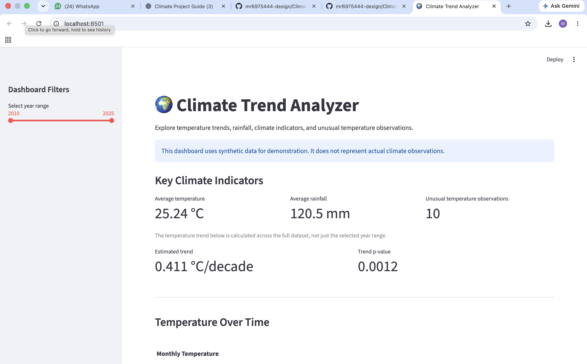

# 🌍 Climate Trend Analyzer

A Python data science project for exploring climate trends, identifying unusual temperature observations, and visualizing climate indicators through an interactive dashboard.

> **Important:** This project currently uses synthetic (simulated) climate data for educational and demonstration purposes. The results do not represent real-world climate observations.


## 🚀 Live Demo

Try the interactive dashboard: [Climate Trend Analyzer](https://climate-trend-analyzer-zsfs6wbk37i4yqvm2iaq88.streamlit.app/)


## ✨ Features

- Generate monthly synthetic climate data.
- Validate data quality and check for missing values and duplicate dates.
- Calculate yearly climate averages.
- Estimate long-term temperature trends while accounting for seasonality.
- Identify unusual temperature observations.
- Explore correlations between climate variables.
- Visualize climate indicators with interactive Plotly charts.
- Filter results by year using a Streamlit dashboard.
- Download filtered climate data as a CSV file.

## 🛠️ Technologies Used

- Python
- Pandas and NumPy
- SciPy and scikit-learn
- Matplotlib and Seaborn
- Plotly
- Streamlit
- Git and GitHub

## 📁 Project Structure

```text
Climate-Trend-Analyzer/
├── app/
│   └── app.py
├── data/
│   ├── raw/
│   └── processed/
├── docs/
├── notebooks/
├── outputs/
│   ├── figures/
│   └── reports/
├── src/
│   ├── analysis/
│   ├── data/
│   ├── forecasting/
│   └── visualization/
├── tests/
├── .gitignore
├── README.md
├── requirements.txt
└── .venv/
```

## 🚀 Getting Started

### 1. Clone the repository

```bash
git clone https://github.com/mr6975444-design/Climate-Trend-Analyzer.git
cd Climate-Trend-Analyzer
```

### 2. Create and activate a virtual environment

On macOS or Linux:

```bash
python3 -m venv .venv
source .venv/bin/activate
```

### 3. Install dependencies

```bash
pip install -r requirements.txt
```

### 4. Generate the synthetic dataset

```bash
python src/data/generate_data.py
```

### 5. Run the analysis

```bash
python src/analysis/climate_analysis.py
```

### 6. Generate the visualizations

```bash
python src/visualization/plot_climate.py
```

### 7. Launch the dashboard

```bash
streamlit run app/app.py
```

## 📊 Current Dataset

The current synthetic dataset contains:

- 192 monthly observations
- Date range: January 2010 to December 2025
- Temperature, rainfall, humidity, CO₂, and sea-level indicators

The dataset is simulated and should not be used to draw conclusions about actual climate conditions.


## 🖥️ Dashboard Preview




## 📈 Analysis

The project calculates yearly averages, estimates a seasonally adjusted linear temperature trend, identifies unusual temperature observations, and calculates correlations between climate variables.

Statistical results are exploratory and depend on the synthetic data and analytical assumptions.

## 🔮 Future Improvements

- Add support for verified real-world climate datasets.
- Improve anomaly detection and statistical validation.
- Add forecasting with appropriate time-series validation.
- Add automated tests.
- Improve dashboard styling and documentation.
- Publish the dashboard online.

## 👩‍💻 Author

Add your name and relevant links here.

## 📄 License

A license has not yet been selected. Add one before presenting the project as an openly licensed repository.
